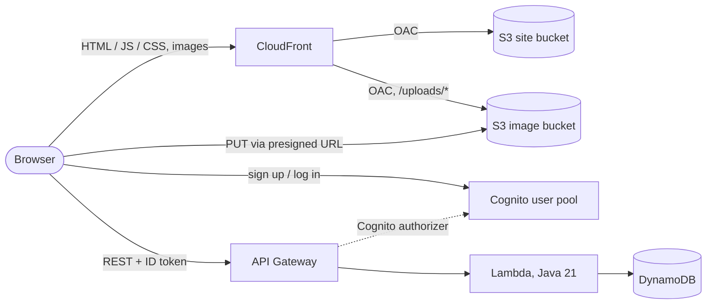

# Serverless Board

A bulletin board (posts, image attachments, comments) built **only with serverless AWS services** and defined as code with the **AWS CDK (Java)**. A practice and portfolio project.

## Architecture

| Service | Role |
|---|---|
| **CDK (Java)** | Infrastructure as code (one stack) |
| **Lambda** | Post and comment CRUD, presigned URL |
| **API Gateway** | REST API with a Cognito authorizer |
| **DynamoDB** | Posts and comments in one table |
| **Cognito** | Sign-up and login (JWT) |
| **S3** | Two private buckets: static site and uploaded images |
| **CloudFront** | Serves the site and images (Origin Access Control) |
| **IAM** | Least-privilege role per function |

## API

Reads are public; writes need a Cognito ID token and, for edits and deletes, ownership.

| Method | Path | Auth |
|---|---|---|
| `GET` | `/posts` | public |
| `POST` | `/posts` | token |
| `PUT` | `/posts/{postId}` | token, owner |
| `DELETE` | `/posts/{postId}` | token, owner |
| `POST` | `/uploads` | token |
| `GET` | `/posts/{postId}/comments` | public |
| `POST` | `/posts/{postId}/comments` | token |
| `DELETE` | `/posts/{postId}/comments/{commentId}` | token, owner |
